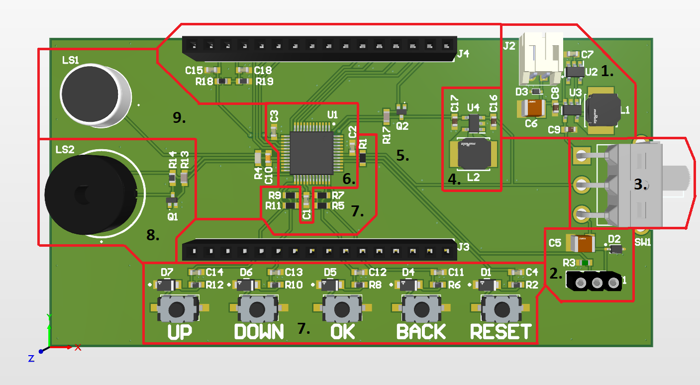

# Pitch-Identifier-Revised

> ### State of the project: designing and testing

The purpose of this device is to identify which pitches are prevalent when a note or harmony is played.
The identified pitch or harmony can be displayed on the LCD.
You can also play notes using the buzzer.

### Sections of the PCB

The design schematic and PCB files can be found [here](https://github.com/k3idi/Pitch-Identifier-Revised/tree/main/PCB%20design%20files).

#### 1. Battery supply

Once the device has been programmed, it will mostly be supplied by batteries, because I want to be able to carry it around and use it without a socket nearby or a power bank in my pocket.
There is a connector for the batteries (J2), a circuit to monitor the combined voltage level of the batteries (U2 and C7) and a voltage regulator to shift the input voltage to 3.3V.
The voltage regulator (U3) circuit also includes decoulping capacitors (C8, C9) and an inductor (L1).
There is also an ESD protection diode for the incoming raw battery supply (D3) and a decoupling capacitor (C6).

#### 2. UPDI interface

The MCU can be programmed using UPDI (Unified Program and Debug Interface).
I will be using Adafruit's [UPDI HV friend](https://www.adafruit.com/product/5893?srsltid=AU7gw4XWTSQ1oTKJ8wCvTU8ZYzTbH97nt85GYQwYwqIZ7k0lGgOxm0xb).
There are ESD protection diodes on the dataline (R3) and the VCC line (D2) and there is a decoupling capacitor (C5).

#### 3, Power switch

This is a three-way switch to choose between power from the battery or UPDI interface,
In the first position, it is supplied by the UPDI HV friend.
In the middle position, it is disconnected from either source.
In the third position, it is supplied by batteries.

#### 4. LCD voltage regulator

This is a circuit to convert 3.3V to 5V for the LCD.
It includes a switching voltage regulator (U4), decoupling capacitors (C16, C17) and an inductor (L2).

#### 5. LCD

The LCD will be connected through the pinheader J4.
There are no traces running to J3, but it will provide stability when connecting the LCD.
There is a decoupling capacitor (C15) to stabilize the LCD's input voltage.
The resistors R18 and R19 divide the voltage such that the contrast pin receives around 0.9V.
There is also a decoupling capacitor near the contrast voltage pin (C18).
The resistor R17 and NPN transistor Q2 allow the brightness of the LCD to be controlled by a PWM signal on the backlight voltage pin.

#### 6. MCU

I chose Atmel's AVR128DB48 as the MCU. 
This MCU has two very useful features.
First, it has built-in op-amps that can be configured as inverting amplifiers and cascaded.
In this configuration, they can be used as the microphone's amplifier.
The inverting amplifiers' amplification can be controlled through software.
Second, it has three separate power supplies, regular VDD, AVDD (analog VDD, which is actually internally connected to VDD) and VDDIO, which allows 8 IO pins to be used at a different voltage level than VDD.
This was useful, because while most of the components required 3.3V, the LCD required 5V.
Thanks to these IO pins, I didn't have to use a logic level shifter.

#### 7. Buttons

There are 4 buttons for regular user interaction and 1 RESET button.
Each button has an ESD protection diode (D1, D4-D7), pull-up and current limiting resistors (R1, R2, R5-R12) and anti-debounce capacitors (C4, C11-C14).

#### 8. Buzzer

The piezoelectric transducer buzzer (LS2) can be controlled by applying a PWM signal to it.
The change in voltage makes the membranes of the buzzer vibrate and produce sound.
The circuit also involves Q1, R13 and R14.

#### 9. Microphone

Because amplification of the microphone signal is handled by the op-amps inside the MCU, then this circuit only invloves the electret microphone capsule itself (LS1), a pull-up resistor for the JFET inside the microphone (R4) and a capacitor to filter out the DC component of the signal (C10).
 

### Photos of the board

*will be added once the PCB has been ordered and soldered*

